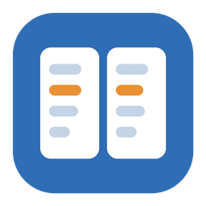

# SideBySide

Windows 탐색기 기능에 **좌우 두 창 비교**(Beyond Compare 방식의 폴더/파일 비교)를 더한 가벼운 파일 관리자입니다.
**한 창 = 탐색기, 두 창 = 일반 창 두 개, 비교 = 두 창을 서로 비교** — `Ctrl+D`(제목 표시줄의 `한 창 | 두 창`)로 창을 하나 더 열고, 필요할 때만 `Ctrl+M`(`비교`)으로 좌우 폴더 비교를 켭니다. 비교를 켜면 두 창이 자동으로 열리고, 두 창을 끄면 비교도 꺼집니다.

- **한 창 (탐색기)**: 탭, 주소 표시줄, 자세히/중간 아이콘/큰 아이콘(썸네일) 보기, 현재 폴더 및 하위 폴더 검색, 미리보기, Windows 원본 우클릭 메뉴, 복사/잘라내기/붙여넣기(탐색기와 호환), 휴지통 삭제, 드래그 앤 드롭, 마우스로 끌어서 영역 선택, 다중 이름 바꾸기, 실행 취소(Ctrl+Z), 터미널 열기, USB 장치 안전하게 제거
- **진행률**: 복사·이동·삭제 진행률을 별도 창 없이 하단 작업 줄(파일 수·용량·속도·남은 시간·취소)과 대상 폴더의 주소 표시줄, Windows 작업 표시줄에 표시
- **두 창 (분할)**: 일반 탐색 창 두 개를 나란히 (각 창 독립 탐색·탭, 비교 표시 없음). `Ctrl+→/←` 복사, `Ctrl+Shift+→/←` 이동, 창 사이 끌기 = 복사 (`Shift`+끌기 = 이동)
- **비교**: 두 창 위에서 켬. 같은 이름끼리 같은 행에 정렬, 다름/한쪽에만 있음 색 표시, 하위 폴더까지 병렬 비교, 차이만 보기, 양쪽 동시 폴더 이동. 한쪽이 "내 PC"면 일반 목록으로 보여주고, 양쪽 모두 폴더를 열면 자동으로 비교. 끄면 두 창은 그대로 일반 목록으로 돌아감
- **파일 비교**: 줄 단위 + 글자 단위 강조, 차이 블록을 반대편에 적용(병합), 직접 편집, 실행 취소, 원본 인코딩·줄끝 유지 저장, 긴 줄 좌우 공용 가로 스크롤(Shift+휠)
- **필터**: `*.tmp; bin\; .git\` 같은 패턴으로 보기 싫은 항목 숨김 (한 창·두 창 공통, 프리셋 저장)
- **비교 세션**: 자주 비교하는 폴더 쌍 + 필터 + 옵션 저장/불러오기

## 요구 사항

- Windows 10 1809 이상 / Windows 11 (x64)
- 실행: [.NET 8 Desktop Runtime](https://dotnet.microsoft.com/download/dotnet/8.0) (런타임 포함 빌드는 불필요)
- 빌드: .NET 8 SDK

## 다운로드

[Releases](https://github.com/sangil1018/sidebyside/releases)에서 받으세요. `selfcontained` 파일은 설치 없이 바로 실행됩니다.

새 버전 배포: `git tag v1.2.3 && git push origin v1.2.3` (또는 Actions → release → Run workflow).
GitHub Actions가 Windows에서 테스트·빌드한 뒤 릴리스를 만들고 exe를 올립니다.

## 빌드 / 실행

```powershell
# 개발 실행
dotnet run --project src/SideBySide.App

# 테스트
dotnet test

# 배포용 단일 exe 만들기 (artifacts\ 폴더)
./build.ps1                 # .NET 런타임 필요, 작은 exe
./build.ps1 -SelfContained  # 런타임 포함, 설치 없이 실행
```

## 명령줄

```text
SideBySide.exe                      마지막 탭 복원
SideBySide.exe <경로>               해당 폴더 열기 (파일이면 폴더 열고 선택)
SideBySide.exe <왼쪽> <오른쪽>       폴더면 폴더 비교, 파일이면 파일 비교로 바로 시작
```

Git difftool로 쓰기:

```powershell
git config --global difftool.sidebyside.cmd '"C:/Tools/SideBySide/SideBySide.exe" "$LOCAL" "$REMOTE"'
git difftool --tool=sidebyside
```

## 단축키

모든 단축키는 `src/SideBySide.App/Commands/CommandRegistry.cs` 한 곳에 정의되어 있고, 버튼 툴팁에도 같은 값이 표시됩니다.

| 단축키 | 동작 | 범위 |
|---|---|---|
| Ctrl+D | 한 창 / 두 창 전환 | 전체 |
| Ctrl+M | 두 창 비교 켜기/끄기 (두 창이 꺼져 있으면 함께 켬) | 전체 |
| Tab | 왼쪽 / 오른쪽 창 전환 | 파일 목록 |
| Alt+P | 미리보기 창 | 전체 |
| Ctrl+Shift+B | 탐색 창 | 전체 |
| Ctrl+H | 숨김 항목 표시 | 전체 |
| Ctrl+Shift+T | 라이트 / 다크 테마 | 전체 |
| Ctrl+, | 환경설정 (테마, 기본 파일 관리자) | 전체 |
| Win+Alt+E (설정에서 변경) | SideBySide 열기 / 열려 있는 창을 앞으로 (설정에서 "꺼져 있어도 사용"을 켜면 앱이 꺼져 있어도 동작) | 전역 |
| Ctrl+Shift+6 / 3 / 2, Ctrl+휠 | 자세히 / 중간 아이콘 / 큰 아이콘 보기 | 전체 (비교 중에는 자세히 고정) |
| Ctrl+T / Ctrl+W | 새 탭 / 탭 닫기 | 전체 |
| Ctrl+Tab / Ctrl+Shift+Tab | 다음 / 이전 탭 | 전체 |
| Alt+← / Alt+→ | 뒤로 / 앞으로 | 전체 |
| Alt+↑, Backspace | 상위 폴더 | 전체 / 파일 목록 |
| F5 | 새로 고침 (두 창: 다시 비교) | 전체 |
| Ctrl+L, F4, Alt+D | 주소 표시줄 편집 | 전체 |
| Ctrl+F | 현재 폴더에서 검색 (입력하면 바로 거름) | 전체 |
| 검색란에서 Enter | 하위 폴더까지 검색 (검색란 오른쪽 폴더 버튼으로도 전환) | 검색란 |
| Esc | 비교 취소 / 검색 지우기 | 전체 |
| Enter | 열기 (두 창: 폴더는 양쪽 진입, 파일은 파일 비교) | 파일 목록 |
| F2 | 이름 바꾸기 (여러 개 선택 시 다중 이름 바꾸기) | 파일 목록 |
| Del / Shift+Del | 휴지통으로 삭제 / 영구 삭제 | 파일 목록 |
| Ctrl+C / Ctrl+X / Ctrl+V | 복사 / 잘라내기 / 붙여넣기 | 파일 목록 |
| Ctrl+Z | 실행 취소 (이름 바꾸기, 이동, 복사, 새로 만들기, 휴지통 삭제) | 파일 목록 |
| Ctrl+Shift+N | 새 폴더 | 전체 |
| Alt+Enter | 속성 | 파일 목록 |
| Ctrl+Shift+C | 경로 복사 | 파일 목록 |
| Shift+F10, 메뉴 키 | Windows 우클릭 메뉴 | 파일 목록 |
| Ctrl+Shift+\` | 여기서 터미널 열기 | 전체 |
| Ctrl+→ / Ctrl+← | 선택 항목을 오른쪽 / 왼쪽 창으로 복사 | 전체 (두 창) |
| Ctrl+Shift+→ / Ctrl+Shift+← | 선택 항목을 오른쪽 / 왼쪽 창으로 이동 | 전체 (두 창) |
| Ctrl+Shift+E | USB 장치 안전하게 제거 (선택한 드라이브 또는 현재 드라이브) | 전체 |
| Ctrl+Shift+F | 필터 | 전체 |
| F7 / Shift+F7 | 다음 / 이전 차이 | 비교 |
| Ctrl+I | 차이만 보기 | 두 창 |
| Ctrl+Shift+D | 선택한 두 파일 비교 | 전체 |
| Ctrl+Shift+S / Ctrl+O | 비교 세션 저장 / 열기 | 전체 |
| Alt+→ / Alt+← | 현재 차이를 오른쪽 / 왼쪽에 적용 | 파일 비교 |
| Ctrl+E | 편집 모드 (양쪽 직접 편집) | 파일 비교 |
| Ctrl+S / Ctrl+Z | 저장 / 실행 취소 | 파일 비교 |
| Esc | 파일 비교 닫기 | 파일 비교 |

마우스: 빈 곳이나 이름 밖(날짜·크기 열)에서 끌기 = 영역 선택 (Ctrl/Shift를 누르면 기존 선택에 추가), Shift+휠(파일 비교) = 가로 스크롤, 가운데 클릭(폴더) = 새 탭에서 열기, 가운데 클릭(탭) = 탭 닫기, 드래그 = 같은 드라이브 이동 / 다른 드라이브 복사 (Ctrl 복사, Shift 이동), 두 창 사이 드래그 = 항상 복사 (Shift 이동).

## 필터 문법

- `;` 또는 줄바꿈으로 구분, `*` `?` 와일드카드, 대소문자 무시
- 끝에 `\`를 붙이면 폴더에만 적용: `bin\; obj\; node_modules\`
- **제외**: 일치하는 파일·폴더 숨김 / **포함**: 일치하는 파일만 표시 (폴더는 탐색을 위해 항상 표시)
- 상단의 필터 칩에서 현재 필터 확인, `×`로 해제

## 파일 작업 진행률

- 복사·이동은 앱 자체 엔진으로 처리해 Windows 진행 창을 띄우지 않습니다. 하단 작업 줄에 현재 파일, `n / N개`, 용량, 속도, 남은 시간이 보이고 `×`로 취소할 수 있습니다.
- 대상 폴더를 보고 있는 탭의 주소 표시줄이 진행률만큼 채워지고, Windows 작업 표시줄 아이콘에도 진행률이 표시됩니다.
- 같은 이름이 있으면 **덮어쓰기 / 둘 다 유지 / 건너뛰기 / 작업 취소**를 묻고, "나머지 모두에 적용"을 고를 수 있습니다. 같은 폴더에 붙여넣으면 `이름 - 복사본`으로 만듭니다.
- 수정·생성 시각과 속성을 그대로 보존하므로 복사한 뒤 비교하면 "같음"으로 나옵니다.
- 휴지통 삭제·영구 삭제도 하단에 진행 표시 (영구 삭제는 확인 후 실행).

## USB 장치 안전하게 제거

탐색 창의 드라이브 목록에서 USB 메모리·외장 디스크·광학 드라이브 옆 `⏏` 버튼(또는 우클릭 → 꺼내기, `Ctrl+Shift+E`)을 누르면 Windows의 "꺼내기"와 같은 방식으로 제거합니다.
그 드라이브를 보고 있던 탭은 먼저 "내 PC"로 옮겨 앱이 장치를 잡고 있지 않게 하고, 결과(안전하게 제거 가능 / 사용 중이라 실패)를 상태 표시줄에 알려 줍니다. 장치를 꽂거나 뽑으면 드라이브 목록이 자동으로 갱신됩니다.

## 검색

- 검색란에 입력하면 현재 폴더를 바로 거릅니다 (`*`, `?` 와일드카드 가능).
- **Enter** 또는 검색란의 폴더 버튼을 누르면 **하위 폴더까지** 검색합니다. 찾는 대로 결과가 나타나고, 목록에 "위치" 열이 생깁니다.
- 필터로 제외한 폴더(`bin\`, `.git\` 등)는 검색하지 않으며, 결과는 최대 20,000개까지 표시합니다.

## 실행 취소 (Ctrl+Z)

SideBySide에서 한 작업을 최근 것부터 최대 50개까지 되돌립니다.

| 작업 | 되돌리기 |
|---|---|
| 이름 바꾸기 / 다중 이름 바꾸기 | 원래 이름으로 |
| 이동 (잘라내기·붙여넣기, 드래그) | 원래 폴더로 다시 이동 |
| 복사 (붙여넣기, 드래그, 반대쪽 창으로 복사) | 만들어진 사본을 휴지통으로 |
| 새 폴더 / 새 텍스트 문서 | 휴지통으로 |
| 휴지통으로 삭제 | 휴지통에서 원래 위치로 복원 |

영구 삭제(Shift+Del), 덮어쓴 파일, 다른 프로그램에서 한 작업은 되돌릴 수 없습니다.

## 비교 기준

| 옵션 | 설명 |
|---|---|
| 크기·날짜 (기본) | 크기와 수정 시각이 같으면 같음. 빠름 |
| 내용 (바이트) | 크기가 같으면 내용을 끝까지 비교. 정확 |
| 시각 허용 오차 | 기본 2초 (FAT/exFAT/네트워크 드라이브 대응) |
| 1시간 차이 무시 | 서머타임·시간대 차이로 인한 정확히 1시간 차이 |
| 하위 폴더까지 비교 | 폴더 행의 색이 안쪽 내용 기준으로 결정됨 (백그라운드 병렬) |

## 성능

- 디렉터리 열거: `FileSystemEnumerable`(Win32 `FindFirstFileEx`)로 FileInfo 할당 없이 백그라운드에서 수행
- 목록: 가상화 + 컨테이너 재활용 — 화면에 보이는 행만 생성 (수만 개 파일도 즉시 표시). 아이콘 보기도 자체 가상화 패널 사용
- 썸네일: 전용 스레드 2개에서 화면에 보이는 항목부터(최근 요청 우선) 생성, 캐시
- 하위 폴더 검색: 백그라운드에서 찾는 대로 스트리밍 표시, 언제든 취소
- 아이콘: 확장자 단위 캐시, 전용 스레드에서 지연 로드
- 비교: 파일 내용 비교와 하위 폴더 비교를 `Parallel.ForEachAsync`로 CPU 코어 수만큼 병렬 처리, 폴더 결과 캐시
- 렌더링: WPF(DirectX) 하드웨어 가속
- 파일 작업은 Windows 셸 엔진(진행률/충돌 대화상자, 실행 취소 지원)을 별도 스레드에서 실행

## 설정 / 로그

- 설정: `%AppData%\SideBySide\settings.json` (창 위치, 탭, 필터 프리셋, 세션, 테마)
- 환경설정 창 (툴바의 톱니 아이콘 또는 Ctrl+,): 테마, **기본 파일 관리자**.
  - 기본 파일 관리자를 켜면 현재 사용자 레지스트리의 폴더 열기 명령 두 곳을 이 앱으로 바꿉니다. 관리자 권한은 필요 없습니다. 바꾸기 전 값은 기억해 두었다가 끄면 그대로 되돌립니다.
    - `HKCU\Software\Classes\Directory\shell\open\command` — 다른 프로그램·실행 창(Win+R)이 폴더를 열 때
    - `HKCU\Software\Classes\Folder\shell\opennewwindow\command` — 탐색기 우클릭 "새 창에서 열기" (`DelegateExecute`를 빈 값으로 덮어써야 탐색기 대신 명령이 쓰입니다)
    - 휴지통·제어판 같은 가상 폴더는 탐색기에 돌려주고, "내 PC"는 SideBySide에서 엽니다.
  - 창 열기 단축키는 Win+Alt+E(기본), Win+Ctrl+E, Win+Shift+E 중 고를 수 있습니다. Win+E와 Win+D는 Windows가 예약해서 쓸 수 없습니다. 같은 키를 다른 프로그램이 쓰고 있으면 등록되지 않고 상태 표시줄에 알립니다.
  - "SideBySide가 꺼져 있어도 단축키 사용"을 켜면 로그인 시 `SideBySide.exe --hotkey-agent`가 창 없이 실행되어(`HKCU\...\CurrentVersion\Run`) 단축키만 잡고 있다가, 누르면 SideBySide를 열거나 열려 있는 창을 앞으로 가져옵니다. 끄면 자동 실행을 지우고 대기 프로세스를 종료합니다.
  - 적용 범위: 다른 프로그램이 폴더를 "열기"로 열 때. Win+E, 작업 표시줄, 탐색기 안에서 폴더를 더블클릭하는 동작은 Windows 탐색기가 그대로 처리합니다.
- 오류 로그: `%LocalAppData%\SideBySide\error.log`

## 수동 점검 목록 (Windows)

자동 테스트는 Core 로직(비교·디프·필터·이름 바꾸기·설정)을 다룹니다. 셸 연동은 Windows에서 직접 확인하세요.

- [ ] Ctrl+D 한 창 ↔ 두 창 전환(비교 없음), Ctrl+M 비교 켜기/끄기, 비교 색상/정렬, F7 이동, Ctrl+I 차이만 보기
- [ ] 두 창에서 Ctrl+→/← 복사, Ctrl+Shift+→/← 이동, 창 사이 끌기(복사)·Shift+끌기(이동)
- [ ] 두 창에서 폴더 더블클릭 시 양쪽 동시 진입, Backspace 양쪽 상위 이동, 한쪽이 "내 PC"일 때 일반 목록
- [ ] 대용량 복사 시 하단 진행률·주소 표시줄 채움·작업 표시줄 진행률·취소, 충돌 대화상자
- [ ] 끌어서 영역 선택 (빈 곳 / 날짜 열 / 아이콘 보기), Ctrl+끌기 추가
- [ ] USB 메모리·외장 하드 꺼내기 버튼, 꽂고 뽑을 때 드라이브 목록 갱신
- [ ] 파일 더블클릭 → 파일 비교, Alt+→ 적용, Ctrl+S 저장 후 인코딩/줄끝 유지
- [ ] 탐색기에서 복사한 파일을 SideBySide에 붙여넣기 (반대 방향도)
- [ ] 우클릭 메뉴(보내기/연결 프로그램 하위 메뉴 포함), Shift+우클릭 확장 메뉴
- [ ] 드래그 앤 드롭 (창 간, 탐색기 ↔ SideBySide)
- [ ] Del 휴지통, Shift+Del 영구 삭제 확인 대화상자
- [ ] 미리보기: 이미지, 텍스트, PDF/Office(미리보기 처리기)
- [ ] 큰 아이콘 보기에서 사진/동영상 썸네일, Ctrl+휠 전환
- [ ] 하위 폴더 검색 (Enter), 결과 더블클릭으로 열기
- [ ] Ctrl+Z: 이름 바꾸기·이동·복사·휴지통 삭제 되돌리기
- [ ] 파일 비교에서 긴 줄 Shift+휠 가로 스크롤
- [ ] 다크 테마 / 시스템 테마 변경 추종, 고DPI 모니터

## 구조

`docs/ARCHITECTURE.md` 참고.

```
src/SideBySide.Core    순수 로직 (UI·Win32 없음) — 비교, 디프, 필터, 이름 바꾸기, 설정
src/SideBySide.Shell   Windows 셸 연동 (아이콘, 파일 작업, 우클릭 메뉴, 클립보드, 미리보기)
src/SideBySide.App     WPF 앱 (MVVM)
tests/                 Core 단위 테스트
```
